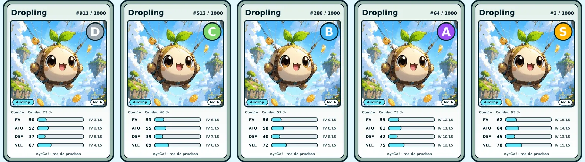
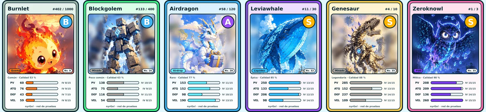

# nyrGo! creature NFTs (testnet)

The NFT is the creature: whoever holds the token has the creature in the game. Each NFT is one
individual, with its own IVs and stats, and an edition number out of a supply that is fixed on
chain per species and can never be raised.

## Supply by rarity

| Rarity    | Species | Editions per species | Most that can exist |
| --------- | ------: | -------------------: | ------------------: |
| Common    |      16 |                1,000 |              16,000 |
| Uncommon  |      12 |                  400 |               4,800 |
| Rare      |      10 |                  120 |               1,200 |
| Epic      |       6 |                   30 |                 180 |
| Legendary |       4 |                   10 |                  40 |
| Mythic    |       2 |                    3 |                   6 |
| **Total** |  **50** |                      |          **22,226** |

Values: `NFT_SUPPLY_BY_RARITY` in `@nyrgo/shared`; registered on the contract with
`pnpm --filter @nyrgo/api nft:species`.

## Grade: from worst to best

The grade comes from the creature's individual values (IVs, 0–15 for each of its four stats):

| Grade | IV total (of 60) | Share of creatures |
| ----- | ---------------: | -----------------: |
| D     |         under 20 |               13 % |
| C     |            20–29 |               35 % |
| B     |            30–39 |               36 % |
| A     |            40–49 |               14 % |
| S     |      50 and over |              1.5 % |

Every card is drawn by the API when the token is minted and served as its image
(`/v1/nft/cards/<token>.png`); its attributes (species, element, rarity, grade, quality, level,
stats, edition, supply) are at `/v1/nft/tokens/<token>.json`. These examples are drawn with
`pnpm --filter @nyrgo/api nft:samples`.
